# 数学大地图

> 这不是一个「知识整理项目」，而是**统一框架的工程化实现**：用一套统一的语言系统重新诠释现代数学的核心概念，使框架本身能够**生成新的数学领域和新的定理**。
> 可视版：[[数学大地图.canvas|数学大地图（Canvas）]]。
> 图例：`★ 已收录` · `◆ 下一个计划` · `◻ 待补`。

## 0. 三条轴（怎么读这张图）

| 轴 | 回答的问题 | 在哪一节 |
| --- | --- | --- |
| **母题** | 什么东西**处处复用**？ | §3 |
| **框架阶梯** | 数学的语言为什么一再升级？ | §2 |
| **学科 / 书** | 有哪些领域与素材？ | §5 |

读法：先用**学科**定位概念，再用**母题**跨域，最后沿**框架阶梯**看「为什么旧语言不够、新语言必须出现」。看到两条不同分支里出现同一个词（对偶、谱、不变量、极限），就顺着 §3 追过去。

## 1. 核心哲学：从「改写定理」到「改变语境」

这个过程并非「改写」定理，而是**为定理提供更深刻、更统一的语境**，使原本孤立的真理在更广阔的图景中显现出必然性。

- 同一个定理，在经典代数里是技巧性结果；
- 在范畴论里是[[泛性质]]的自然后果；
- 在无穷范畴里是高阶结构的特例；
- 在朗兰兹／凝聚框架里是整个统摄系统的必然。

这不是「换个说法」，而是**改变了对象本身、改变了等价概念、改变了证明方向**。详见 [[数学统一的地平线]]。

## 2. 框架阶梯：坏性质如何推动升级

**每一次框架升级的必然性，都来自上一级框架自身的困难。** 这些困难与解决它们的方案，本身就是新数学的源头。

| 升级 | 旧框架的坏性质 | 新框架的救赎 | 收获 |
| --- | --- | --- | --- |
| 经典 → **范畴** | 用元素与等式描述，构造依赖任意选择，自然性破裂 | 用态射替代元素、用伴随替代构造，自然变换保证自然性 | 世界更一致、更对称、更易推广 |
| 范畴 → **无穷范畴** | 函子合成是「严格」的，而自然出现的映射只是同伦可交换 | 同伦等价成为基本的「相等」 | $A_\infty$、$E_\infty$ 等高阶结构与普通代数一样自然 |
| 无穷范畴 → **同伦类型论** | 无穷范畴仍用「集合 + 同伦」定义，基础依赖 ZFC | 把等价作为基本概念；单价公理「同构即相等」 | 从逻辑基础层支持结构主义，形式化验证成为可能 |
| → **凝聚数学 / 朗兰兹** | 涉及无穷乘积、连续性时仍需要「拓扑」，且各领域「连续」概念不同 | 凝聚集用「能被什么探测」替代「由什么点组成」；朗兰兹对应创造领域间翻译字典 | 数论、几何、分析同一框架；定理成为朗兰兹对应的具体表现 |

> 一句话链条：**坏性质 → 新框架 → 新问题 → 更强的框架**。它在凝聚数学与朗兰兹纲领处达到（暂时的）高峰，但仍有新问题等待。

## 3. 三大母题：跨越全景

**这是全图的核心。** 分支分类告诉你「有哪些领域」，母题告诉你「什么东西处处复用」。展开见 [[数学的三大母题]]。

| 母题 | 出现地（本库） | 范畴论统摄 | 深化 / 大一统 |
| --- | --- | --- | --- |
| **对偶性** | [[对偶空间]]（Axler）· [[伽罗瓦理论]]（Artin）· [[傅里叶积分与傅里叶变换]]（高木）· [[对偶变换与对偶原理]]（Klein）· [[模2度]]（Milnor） | 所有对偶 = $\operatorname{Hom}(\_,k)$ 的**伴随** | 导出对偶 = 外函子的伴随；朗兰兹对偶群 |
| **泛性质 / 自由对象** | [[自由群与生成元关系]] · [[模]] · [[双线性型]]（张量积）· [[群表示与特征标]]（诱导）· [[积与商空间]] | 自由对象 = 遗忘函子的**左伴随** | 伴随函子对生成所有有用构造；本库「从区分生成结构」是其元层版本 |
| **不变量 / 导函子** | [[迹与行列式]] · [[向量场与欧拉数]] · [[模2度]] · [[充分统计量]] · [[矩阵范数与条件数]] | 不变量 = 函子；导函子把静态数值升级为机器 | 无穷范畴的高阶不变量；分离曲率 $\kappa$ 是本库的新不变量 |

**母题三问**：这个新对象**探测**了什么？它与其他母题如何**对偶 / 伴随**？它是否**打开新问题**？

## 4. 生成新数学的方法论

本库的生成力来自五个动作（详见 [[统一抽象统摄方法论]]）：

1. **发现经典框架的坏性质**——不是批评，而是观察其自然边界；
2. **理解为什么需要新框架**——从问题出发，而非从抽象出发；
3. **用新框架改写经典定理**——看到同样的真理在新语境中的必然性；
4. **标注打开的新问题**——新框架总是打开新的可能；
5. **追踪这些新问题指向更强的框架**——趋向凝聚、同伦、朗兰兹。

这五个动作合起来就是**数学生成**的过程。本库据此自建了一套框架并做了逐领域检验，见 §6。

## 5. 学科与书目（自动目录）

> 分支只是看数学的**一个**视角；真正的价值在**联系**。下列书目由 `map.config.json` 自动生成，仅作素材导航，不再罗列导读与概念清单。

```mermaid
graph TD
  M[数学]
  M --> base[基础]
  M --> guide[数学导览]
  guide --> PCM[普林斯顿数学指南 ★]
  M --> alg[代数]
  alg --> AT[代数Artin ★]
  alg --> LA[线性代数应该这样学 ★]
  M --> ana[分析]
  ana --> CA[托马斯微积分 ★]
  ana --> CM[微积分入门 ★]
  ana --> MA[数学分析概论 ★]
  M --> geo[几何与拓扑]
  geo --> DT[从微分观点看拓扑 ★]
  M --> elem[初等数学（高观点）]
  elem --> KG[高观点下的初等数学 ★]
  M --> prob[概率与统计]
  prob --> PD[概率导论 ★]
  prob --> SP[随机过程 ★]
  prob --> SS[统计学七支柱 ★]
  prob --> BT[贝叶斯思维 ★]
  prob --> FT[肥尾效应 ★]
  M --> disc[离散数学与理论CS]
  disc --> CSAPP[深入理解计算机系统 ★]
  disc --> MOS[现代操作系统 ★]
  disc --> CP[编译原理 ★]
  M --> num[数值与计算]
  num --> NLA[数值线性代数 ★]
  M --> iris[数据科学 · 鸢尾花书]
  iris --> MX[矩阵力量 ★]
  iris --> LNA[线性代数不难 ★]
  iris --> SJ[数学要素 ★]
  iris --> TZ[统计至简 ★]
  iris --> DY[数据有道 ★]
  iris --> MLI[机器学习 ★]
  M --> app[应用与交叉]
```

<!-- MAP:AUTO:START -->


### 基础 ◻
- ◻ 集合论 · 数理逻辑
- ◻ 公理化 · 范畴论
- ◻ 证明 / 类型论

### 数学导览
- [[普林斯顿数学指南]]
- ◻ 数学史 · 数学家传记
- ◻ 数学百科 · 工具书

### 代数
- [[代数Artin]] · [[线性代数应该这样学]]
- ◻ 抽象代数 · 表示论
- ◻ 交换代数 · 同调代数
- ◻ 数论

### 分析
- [[托马斯微积分]] · [[微积分入门]] · [[数学分析概论]]
- ◻ 实分析 · 复分析 · 泛函
- ◻ 微分方程 · 调和分析

### 几何与拓扑
- [[从微分观点看拓扑]]
- ◻ 点集拓扑 · 代数拓扑
- ◻ 微分几何 · 黎曼几何

### 初等数学（高观点）
- [[高观点下的初等数学]]
- ◻ 初等算术 · 数论
- ◻ 经典几何 · 尺规作图

### 概率与统计
- [[概率导论]] · [[随机过程]] · [[统计学七支柱]] · [[贝叶斯思维]] · [[肥尾效应]]
- ◻ 信息论
- ◻ 因果推断

### 离散数学与理论CS
- [[深入理解计算机系统]] · [[现代操作系统]] · [[编译原理]]
- ◻ 组合 · 图论
- ◻ 算法 · 可计算性

### 数值与计算
- [[数值线性代数]]
- ◻ 最优化 · 科学计算
- ◻ 数值微分方程

### 数据科学 · 鸢尾花书
- [[矩阵力量]] · [[线性代数不难]] · [[数学要素]] · [[统计至简]] · [[数据有道]] · [[机器学习]]
- ◻ 深度学习 · 大模型
- ◻ 强化学习

### 应用与交叉 ◻
- ◻ 数学物理 · 数据科学
- ◻ 金融数学 · 运筹学
<!-- MAP:AUTO:END -->

## 6. 本库的实践：从方法论到自建框架

### 6.1 一套方法论

[[统一抽象统摄方法论]]：识别冗余层次 → 构造统摄性抽象 → 重定义基本概念 → 重述经典定理 → 检验简化与有效性。它的有效性由**压缩比 / 统一度 / 问题解决力 / 可迁移性**四条判据裁决，不是靠「看起来更优雅」。

### 6.2 一个自建框架

[[演化区分系统与分离曲率]]：以「区分动作」为基本对象、以分离曲率 $\kappa$ 为核心不变量，把线性代数、拓扑、测度、信息论、LLM 纳入同一语言。它的**严格核心**是图上演化区分系统的相变定理（$\beta_1=\alpha/\lambda_n$，$\beta_2=\alpha/\lambda_2$，[[图与拉普拉斯矩阵]] + [[谱定理]]），可在标准数学中形式化。

### 6.3 逐领域检验（15 个传统领域）

| 适用强度 | 领域 |
| --- | --- |
| **强**（可严格或强结构） | 图论 · 线性代数 · 组合数学 · 格论 · 信息论（曲率表述） |
| **中**（有框架、缺证明） | 概率论 · 微分方程 · 微分几何 · 算子代数 · 量子数学 · 博弈论 |
| **弱 / 边界**（时间维度缺失） | 动力系统与混沌 · 数论 · 部分几何（Gauss–Bonnet 因子 3 未解） |

### 6.4 从框架涌现的新领域

统一框架的组合空缺就是新领域候选：**区分几何学**（分离曲率的几何）、**时间区分理论**（时间作为区分演化的副产品）、**超有限李理论**、**凝聚区分论**、**演化数论**、**量子区分理论**、**区分机器学习理论**（涌现 = 分离曲率相变）。详见 [[演化区分系统与分离曲率]]。

## 7. 三种输出（按框架，而非按学科）

### 输出 1 · 概念升级路线网络

```
【概念：群】
经典定义（Artin） → 遇到的坏性质 → 范畴论升级（群对象/伴随） → 同伦论升级 → 朗兰兹角色
每个箭头都标注：前一框架为何不够 / 新框架如何解决 / 打开了什么新问题
```

### 输出 2 · 母题的完整演进图

```
【母题：对偶性】
Axler 对偶空间 → Milnor 上同调 → 高木 Fourier → Artin 伽罗瓦 → Klein 对偶原理
        ↓ 范畴论统摄（伴随）
        ↓ 无穷范畴深化（导出对偶）
        ↓ 朗兰兹 / 凝聚大一统
        ↓ 生成的新问题与新结果
```

### 输出 3 · 按框架的学习路径（从泛性质理解整个现代数学）

1. **第一阶段**：看泛性质如何统一「所有自由对象」（自由群、自由模、张量积）；
2. **第二阶段**：看泛性质如何产生伴随函子对；
3. **第三阶段**：看伴随对如何在不同领域反复出现（对偶、极限、上同调）；
4. **第四阶段**：看它如何在凝聚数学中变成「所有构造都围绕伴随」；
5. **第五阶段**：看朗兰兹纲领如何用伴随函子的语言陈述数学统一。

（配套的阅读顺序见 [[知识索引]] 与各书；本库现有书目作为这条路径的**素材**，而非终点。）

## 8. 地基与诚实评估

> 「这是 [[演化区分系统与分离曲率|框架]] 的真实状态，不是它的失败。」

- **严格硬核**：图上演化区分系统、有限维线性代数、组合数学——可形式化（Lean/Mathlib）；
- **部分严格**：黎曼流形（Gauss–Bonnet 因子 3 未解）、超有限测度、谱分解系统；
- **启发式**：LLM 相变、信息曲率、概率条件区分、微分方程分离曲率有界性；
- **概念层**：时间区分、量子区分、区分几何学——有定义无定理。

框架目前是「**地基是石头、上层是木头**」。要成为真正的数学统一理论，最优先的任务不是扩展到更多领域，而是**把已有领域的证明补上**（首推黎曼流形的因子 3 问题）。研究如何诚实地发布与检验，见 [[研究纲领的发布与检验]]。

## 9. 如何扩展这张图

- **新母题** → 在 §3 增一行，并在 [[数学的三大母题]] 展开（候选：范畴化 / 提升、局部—整体、随机化）。
- **新框架** → 在 §2 阶梯补一级，说明它的「坏性质」来自哪。
- **新领域 / 新书** → 在 `map.config.json` 登记后运行 `update-map.mjs`，书目自动进入 §5。
- **新联系** → 跨分支更系统性时，新增 [[主题索引|主题页]] 并挂到 [[数学的三大母题]] 或 §6。
- 维护规范见 [[AGENTS]] 与 `.pi/skills/build-wiki/`；可视版 `数学大地图.canvas` 同步更新（id 唯一、边不悬空）。

## 核心原则

✓ 不是「知识展示」，而是**框架生成**；✓ 不是「多视角观察」，而是**追踪框架为何升级**；
✓ 不是「学科分类」，而是**母题的必然演进**；✓ 不是「静态教学」，而是**动态问题生成**；
✓ 每个新框架的必然性都来自经典框架的自身困难；✓ 这个过程在朗兰兹与凝聚数学中达到（暂时的）高峰，但仍有新问题等待。

## 相关

- [[数学的三大母题]] · [[数学统一的地平线]] · [[统一抽象统摄方法论]] · [[演化区分系统与分离曲率]] · [[研究纲领的发布与检验]]
- [[总索引]] · [[知识索引]] · [[素材索引]] · [[产出索引]] · [[主题索引]] · [[概念索引]]
